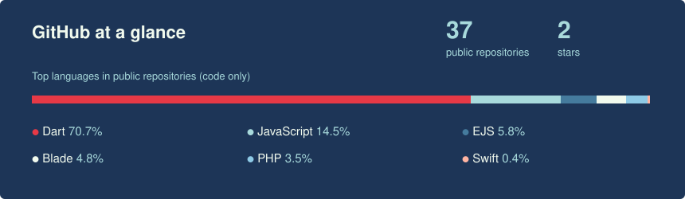

**Maaz Zindani** is a remote senior software engineer who builds and runs mobile apps, web platforms and back ends for teams worldwide, and looks after IT and software development projects overall: data, cloud and releases included. He designed, built and runs **TaxiDex**, a taxi dispatch SaaS, and owns Stegnor LLC. Full profile at [maazzindani.com](https://www.maazzindani.com) and the [facts page](https://www.maazzindani.com/facts/).

  <a href="https://www.maazzindani.com"><b>Website</b></a> &nbsp;·&nbsp;
  <a href="https://www.maazzindani.com/projects/">Projects</a> &nbsp;·&nbsp;
  <a href="https://www.maazzindani.com/services/">Services</a> &nbsp;·&nbsp;
  <a href="https://www.maazzindani.com/fix/">Fixes</a> &nbsp;·&nbsp;
  <a href="https://www.maazzindani.com/contact/">Contact</a>

## What I build

- [Full-stack product development](https://www.maazzindani.com/services/full-stack-development/): database, API, portal, apps and deploys
- [Mobile apps](https://www.maazzindani.com/services/flutter-app-development/): Flutter, with native Kotlin and Swift where needed
- [Back end and DevOps](https://www.maazzindani.com/services/backend-devops/): APIs, servers, CI and monitoring
- [MVP development](https://www.maazzindani.com/services/mvp-development/): a first version real users can pay for
- [AI integration](https://www.maazzindani.com/services/ai-integration/): LLM features that are safe in production
- [Technical leadership](https://www.maazzindani.com/services/technical-leadership/): architecture, reviews and a team that ships
- [App modernization and rescue](https://www.maazzindani.com/services/app-modernization/): take over, stabilise and upgrade old apps
- [Remote software engineer](https://www.maazzindani.com/services/remote-software-engineer/): a senior engineer inside your team

## Own product: TaxiDex

[**TaxiDex**](https://taxidex.com) is my own multi-tenant taxi dispatch SaaS. I designed it, built it and run it: the API, the dispatcher portal, the driver and passenger apps, and the servers underneath.

| 1,000+ | 3,000+ | 200+ | 2 |
|:---:|:---:|:---:|:---:|
| API routes | automated tests | portal pages | Flutter apps on Google Play |

[Case study](https://www.maazzindani.com/projects/taxidex/) · [taxidex.com](https://taxidex.com) · [Driver app](https://play.google.com/store/apps/details?id=com.taxidex.driver) · [Passenger app](https://play.google.com/store/apps/details?id=com.taxidex.customer)

## Selected work

- [**Qist Bazaar**](https://www.maazzindani.com/projects/qist-bazaar/): buy-now-pay-later marketplace, built from a blank repo, past 100K downloads on Google Play
- [**Dispatch Pro**](https://www.maazzindani.com/projects/dispatch-pro/): real-time logistics with Flutter apps, Spring Boot services and a Kafka pipeline on AWS
- [**ShopGo**](https://www.maazzindani.com/projects/shopgo/): e-commerce aggregator with a Python scraping engine, past 10K downloads
- [**Menulo**](https://www.maazzindani.com/projects/menulo/): restaurant discovery in Germany, fed by a Python ingestion pipeline
- [**Loade Driver**](https://www.maazzindani.com/projects/loade-driver/): live jobs, routing and earnings for delivery drivers, past 5K downloads
- [**Ohana Africa**](https://www.maazzindani.com/projects/ohana-africa/): consumer app on a Firebase real-time back end, past 10K downloads

## Work with me

- [Monthly plans](https://www.maazzindani.com/plans/): fractional CTO, app and server care, dedicated engineer and more
- [C2C contracts](https://www.maazzindani.com/plans/c2c-contract-engineer/): contract engineer through Stegnor LLC
- [Freelance by stack](https://www.maazzindani.com/freelance/): pick the technology you need
- [Contact](https://www.maazzindani.com/contact/): tell me the problem, who it is for and any deadline

## Fix library

Step-by-step fixes for production errors: the check, the fix and the proof it worked. Start at [/fix/](https://www.maazzindani.com/fix/), or jump to a hub:
[Servers, nginx and Docker](https://www.maazzindani.com/fix/servers/) · [Flutter and app store releases](https://www.maazzindani.com/fix/mobile/) · [Next.js and React](https://www.maazzindani.com/fix/web/) · [Payments](https://www.maazzindani.com/fix/payments/)

## Tech stack

  
  
  
  
  
  
  
  
  
  
  
  
  
  
  
  

## GitHub stats

  
  

## Find me

  
  
  
  

